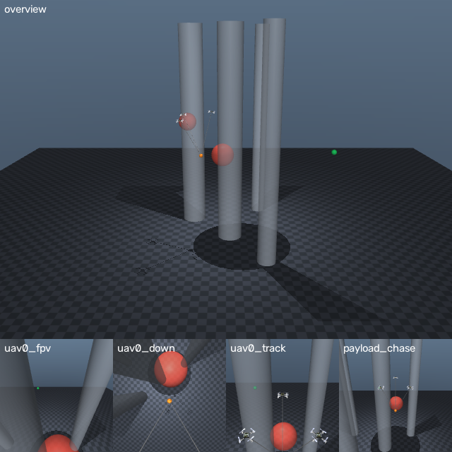

# UAV Arena

A MuJoCo world-model arena for three-UAV cooperative transport of a cable-suspended payload.

Three official Crazyflie 2 airframes carry one payload on 0.6 m cables from a start to a goal, past
pillars and moving spheres. Each aircraft runs the pinned upstream Lee flight controller (C, 500 Hz).
A planner or policy sends one position setpoint per aircraft every 100 ms and sees the team with an
observation delay of 0 to 200 ms. The simulator is the ground truth, so the arena measures how close
a world model's predictions, and the decisions made with them, come to it.

This release makes the task tunable:

| Setting | What you can change | Default (arena-v0.3) |
|---|---|---|
| Payload | mass range or a fixed mass, the nominal mass the controllers assume, hidden or public | 10–40 g per layout seed, hidden; nominal 25 g |
| Wind | mean speed and heading, discrete gusts, continuous turbulence, hidden or public | still air |
| Cameras | onboard, downward, chase, payload-following and overview cameras, or your own; RGB or depth | none |
| Obstacles | number and size of pillars; number, size and speed of moving spheres | 4 pillars, 2 spheres |
| Episode | time limit, goal tolerance | 20 s, 0.15 m |

With the default settings the arena is arena-v0.3, the frozen version of the research code, bit for
bit ([docs/reproduction.md](docs/reproduction.md)).

## Install

```bash
git clone https://github.com/ArcueidMP/uav-arena.git
cd uav-arena
pip install -e ".[all]"
```

You need Python 3.10 to 3.13 (MuJoCo 3.3.0 has no wheels for 3.14), Linux or macOS, and a C compiler
(`cc`). The onboard controller is
compiled on first use and cached in `~/.cache/uav-arena` (or `$UAV_ARENA_BUILD_CACHE`). MuJoCo is
pinned to 3.3.0, because MuJoCo releases change numerics. To render cameras on a machine without a
display, set `MUJOCO_GL=egl` (GPU) or `MUJOCO_GL=osmesa` (CPU).

| Extra | Adds | For |
|---|---|---|
| (none) | MuJoCo, NumPy, SciPy | the environment, scenarios, settings, cameras |
| `gym` | Gymnasium | `ArenaGymEnv` |
| `plan` | PyTorch, stable-worldmodel 0.1.1 | the shared MPPI planner, the reference rows, the evaluation tools |
| `video` | OpenCV | replay videos (`replay video`) |
| `all`, `dev` | everything; pytest | |

## Quickstart

```python
from uav_arena import ArenaEnv, CONDITIONS, make_scenario

scenario = make_scenario(seed=0, condition=CONDITIONS[0])   # static pillars, no latency
env = ArenaEnv(scenario)
obs = env.reset()                                    # the team hovers, settled, at t = 0
while not env.done:
    setpoints = obs["recent_setpoints"][-1]          # (3, 3) world-frame setpoints; your policy here
    obs, reward, done, info = env.step(setpoints)
print(info["outcome"])                               # "timeout": holding the hover never reaches the goal
```

`CONDITIONS` crosses two obstacle settings (`static`, `static+moving`) with four latencies
(0, 50, 100, 200 ms). A layout seed fixes the start, goal, obstacles, payload mass and wind in all
eight conditions, so condition effects are paired.

### Tune the task

```python
from uav_arena import GustSettings, PayloadSettings, TaskSettings, TurbulenceSettings, WindSettings

settings = TaskSettings(
    payload=PayloadSettings(mass_range=(0.02, 0.06)),       # kg, drawn per layout seed, hidden
    wind=WindSettings(speed=(0.0, 2.0),                      # m/s mean wind, any heading
                      gusts=GustSettings(rate=0.2, peak=(1.0, 3.0)),
                      turbulence=TurbulenceSettings(intensity=(0.3, 0.3, 0.1))),
)
env = ArenaEnv(make_scenario(seed=0, condition=CONDITIONS[5], settings=settings))
```

Settings round-trip through JSON. `run`, `collect`, `record` and `replay record` take them as
`--settings file.json`; `openloop` and `harness` read the scenario family from the episode files.
[docs/settings.md](docs/settings.md) covers each setting: its physics, its limits (for example, the
heaviest payload the team can carry with control headroom), and what the methods may see.

### Cameras

```python
from uav_arena.cameras import onboard_cameras, overview_camera

env = ArenaEnv(scenario, cameras=(*onboard_cameras(), overview_camera()))
obs = env.reset()
obs["images"]["uav0_fpv"]          # (64, 64, 3) uint8, drawn from the same delayed state as obs
```



*The overview camera, then aircraft 0's onboard, downward and chase cameras and the
payload-following camera, 1.5 s into an episode with moving obstacles (`python examples/cameras.py`).*

Cameras never touch the physics. [docs/cameras.md](docs/cameras.md) lists the presets and explains
how to mount your own.

### Gymnasium

```python
from uav_arena.gym_env import ArenaGymEnv

env = ArenaGymEnv(settings=settings, cameras=onboard_cameras(), render_mode="rgb_array")
obs, info = env.reset(seed=0)      # obs: {"state": (118,), "uav0_fpv": (64, 64, 3), ...}
```

The action is each aircraft's setpoint increment, in [-1, 1] times 0.12 m per axis. Without cameras
the observation is the flat state vector.

### Planners, data and evaluation

| Command | What it does |
|---|---|
| `python -m uav_arena.run --predictor oracle --suite dev --seeds 0:5 --out runs/oracle_dev.json` | Closed loop with the shared MPPI planner. The predictor is a reference row (`oracle`, `physics`, `adaptive`) or your world model as `module:factory`. |
| `python -m uav_arena.collect --seeds 200000:202000 --out runs/datasets/explore_v2` | World-model training data; `--verify DIR` checks a dataset against the published manifests. |
| `python -m uav_arena.openloop --predictor ... --data DIR --out FILE` | Open-loop prediction error on collected episodes. |
| `python -m uav_arena.record ...`, then `python -m uav_arena.harness ...` | Decision-level probes on states recorded from the oracle's flights. |
| `python -m uav_arena.replay record/view/video ...` | Episode recordings, an interactive viewer and MP4 videos. |

[docs/participants.md](docs/participants.md) shows how to plug in a world model and lists the
information rules that every method follows.

## The task in brief

- **Plant:** three Menagerie Crazyflie 2 airframes (official meshes, mass and inertia), 0.6 m
  tension-only cables, a central spherical payload, first-order rotor dynamics, and 2 ms physics.
- **Onboard:** per aircraft, the unchanged `controller_lee.c` from IMRCLab's firmware at 500 Hz, a
  bounded rotor mixer, and a cable-load feedforward for the nominal payload mass.
- **Action:** one world-frame position setpoint per aircraft every 100 ms. Onboard, each setpoint
  ramps linearly from the previous one with matching velocity feedforward, and a geofence clips it
  to within 0.5 m of the aircraft.
- **Observation:** the team's positions, velocities, attitudes and body rates; the payload's
  position and velocity; obstacles; the goal; and the last four setpoints sent. Everything is
  recorded `latency` before the decision. The payload mass, the wind, cable tensions and onboard
  states are not observed.
- **Episode:** starts from a settled hover; succeeds when the payload stays within the goal
  tolerance and below 0.2 m/s for 0.5 s; fails on contact with an obstacle (aircraft, payload or
  cable), aircraft closer than 0.1 m, a crash, leaving the workspace, or the time limit.
- **Reference rows:** the oracle U forks the true simulator. The physics row runs the same
  simulator with the nominal payload mass from the delayed observation. The adaptive row adds
  online payload-mass estimation. All three plan with the same MPPI and cost as every world model.

## Roadmap

Next on the list: a variable team size (N = 2 to 6 aircraft) for a scalable multi-agent benchmark,
spatially varying wind, and rotor drag. See [docs/roadmap.md](docs/roadmap.md).

## License

UAV Arena is licensed under the GNU General Public License v3.0 only ([LICENSE](LICENSE)). It vendors
the Menagerie Crazyflie 2 model (MIT) and the Lee controller from IMRCLab's crazyflie-firmware
(`controller_lee.c` and `math3d.h` under MIT; the firmware interface headers under GPL-3.0); see
[THIRD_PARTY_NOTICES.md](THIRD_PARTY_NOTICES.md).
